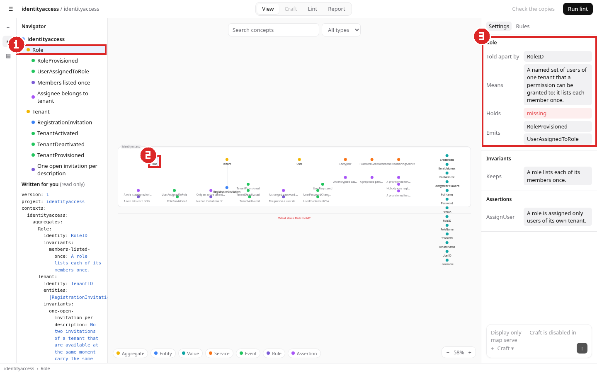
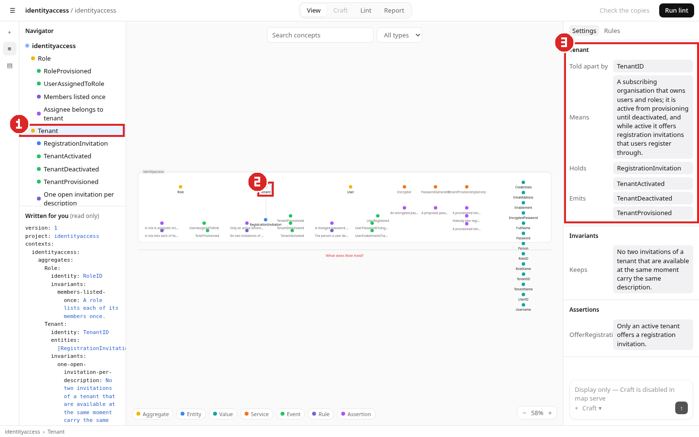
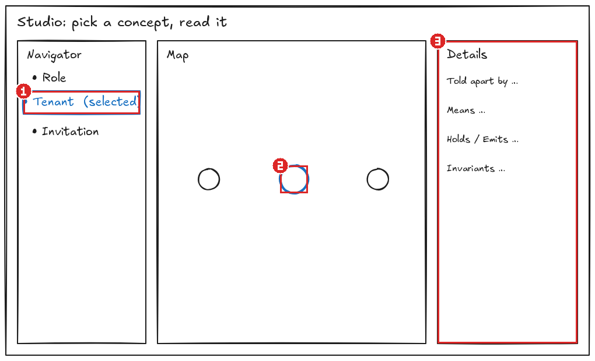

## Before and after: docs/evidence/feature-sketch-evidence/concept-details.excalidraw

Sketch: [`docs/evidence/feature-sketch-evidence/concept-details.excalidraw`](https://raw.githubusercontent.com/wixregiga/arclint/feature-sketch-evidence/docs/evidence/feature-sketch-evidence/concept-details.excalidraw). Each number marks the same change on both screenshots and links to the named sketch part it implements.

| Before (current) | After (target) |
| --- | --- |
|  |  |

| # | Sketch part | Before: now | After: target | Links |
| --- | --- | --- | --- | --- |
| 1 | [`nav-selection`](https://raw.githubusercontent.com/wixregiga/arclint/feature-sketch-evidence/docs/evidence/feature-sketch-evidence/concept-details.excalidraw#nav-selection) • Tenant  (selected) | Role is selected | Tenant is selected | Tenant |
| 2 | [`map-node`](https://raw.githubusercontent.com/wixregiga/arclint/feature-sketch-evidence/docs/evidence/feature-sketch-evidence/concept-details.excalidraw#map-node) Selected node | Role node highlighted | Tenant node highlighted | Tenant |
| 3 | [`details-panel`](https://raw.githubusercontent.com/wixregiga/arclint/feature-sketch-evidence/docs/evidence/feature-sketch-evidence/concept-details.excalidraw#details-panel) Details panel | Role's identity, meaning, events | Tenant's identity, meaning, holds and events | Tenant, one-open-invitation-per-description |

Sketch with the same numbers

