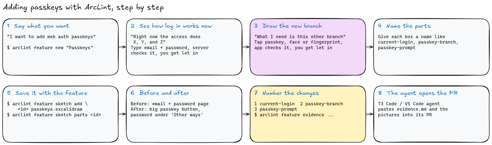
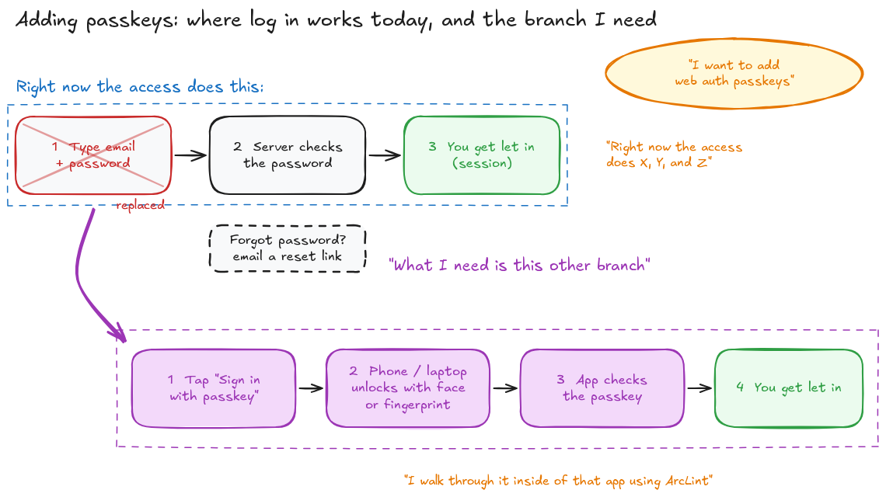
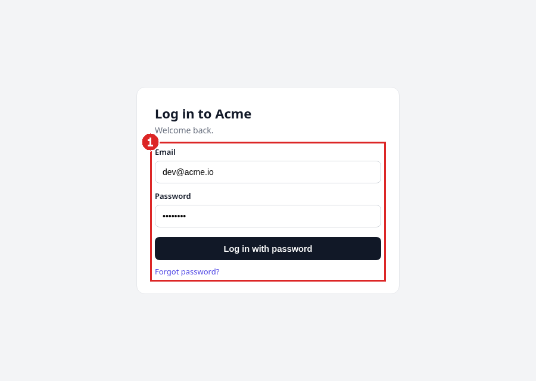
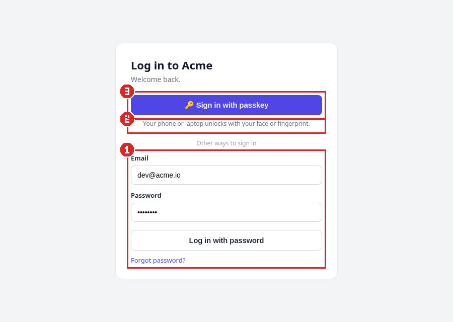
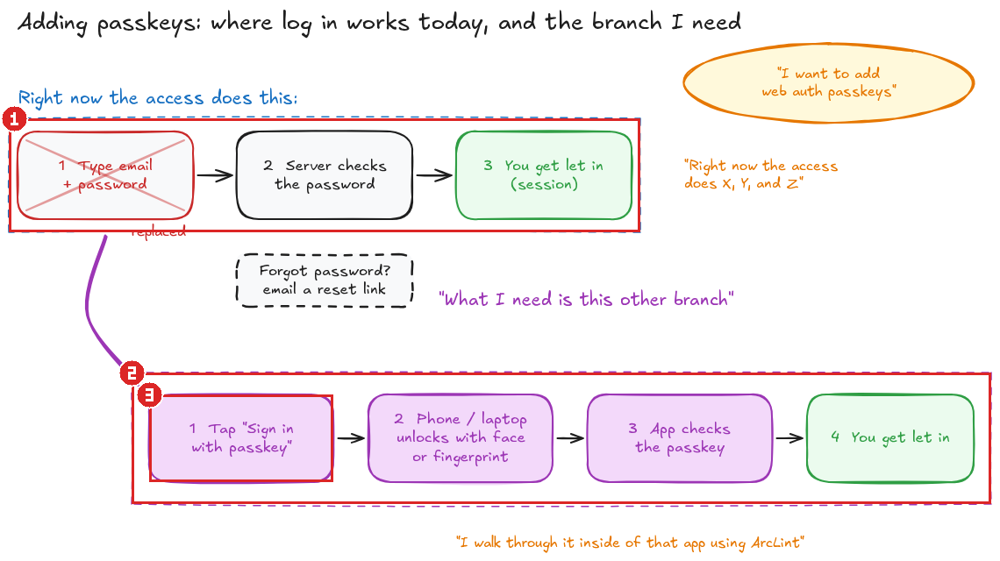

# Worked example: adding passkeys with ArcLint

> "I want to add web auth passkeys."
>
> "Right now the access does X, Y, and Z."
>
> "I walk through it inside of that app using ArcLint. I draw: okay, right now the access does this."
>
> "What I need is this other branch."

This folder is a real ArcLint project. Everything in it came from the commands below, run from this folder. The outputs are copied as they printed.



## 1. Say what you want

You want people to log in with a passkey instead of typing a password. Start a feature for it:

```console
$ arclint feature new "Passkeys" --body "Let people log in with a passkey: the phone or laptop unlocks with face or fingerprint, and the app checks the passkey. Email and password stays as another way to sign in."
created feature 54c300236da7b0fd98b111834c62b0d3
```

## 2. Draw how log in works today, and the branch you need

Draw it in Excalidraw (or any tool that saves `.excalidraw`). The top row is how it works today: you type your email and password, the server checks the password, and you get let in. The arrow is the new branch: you tap "Sign in with passkey", your phone or laptop unlocks with your face or fingerprint, the app checks the passkey, and you get let in. The password step is crossed out because the passkey replaces it as the main way in.

Give each box you want to point at a short name by putting `{"arclintId": "..."}` in its custom data. Here the names are `current-login`, `password-check`, `let-in`, `passkey-branch`, `passkey-prompt`, `device-unlock` and `passkey-check`.



Source: [passkeys.excalidraw](passkeys.excalidraw)

## 3. Save the sketch with the feature and list its named parts

```console
$ arclint feature sketch add 54c300236da7b0fd98b111834c62b0d3 passkeys.excalidraw
sketch 54c300236da7b0fd98b111834c62b0d3.sketch.excalidraw attached to feature 54c300236da7b0fd98b111834c62b0d3
current-login	Today: log in with email + password	log-in, session
password-check	1 Type email + password	password
let-in	3 You get let in (session)	session
passkey-branch	The new branch: log in with a passkey	passkey, log-in
passkey-prompt	1 Tap "Sign in with passkey"	passkey
device-unlock	2 Phone / laptop unlocks with face or fingerprint	device, passkey
passkey-check	3 App checks the passkey	passkey, check-who-you-are

$ arclint feature sketch parts 54c300236da7b0fd98b111834c62b0d3
current-login	Today: log in with email + password	log-in, session
password-check	1 Type email + password	password
let-in	3 You get let in (session)	session
passkey-branch	The new branch: log in with a passkey	passkey, log-in
passkey-prompt	1 Tap "Sign in with passkey"	passkey
device-unlock	2 Phone / laptop unlocks with face or fingerprint	device, passkey
passkey-check	3 App checks the passkey	passkey, check-who-you-are
```

The sketch now lives next to the feature in `.arclint/studio/features/`.

## 4. Take a screenshot before and after

Before: the login page only has email and password. After: a big "Sign in with passkey" button at the top, and the password form moved under "Other ways to sign in". The raw screenshots are [before-raw.png](before-raw.png) and [after-raw.png](after-raw.png).

## 5. Number the changes and point each one at the sketch

[callouts.json](callouts.json) says which box on which screenshot is which numbered change:

1. `current-login`: the old email + password form.
2. `passkey-branch`: the new way in, where your phone or laptop unlocks.
3. `passkey-prompt`: the "Sign in with passkey" button.

```console
$ arclint feature evidence callouts.json --out . --link-base https://raw.githubusercontent.com/wixregiga/arclint/feature-sketch-evidence/docs/evidence/passkeys/
wrote before.png
wrote after.png
wrote sketch.png
wrote evidence.md
```

| Before | After |
| --- | --- |
|  |  |

The same numbers on the sketch:



[evidence.md](evidence.md) is the markdown an agent pastes into the pull request. Each number links back to the named part of the sketch.

## 6. Let your agent do it

`arclint feature skill` installs the feature-evidence skill, so a coding agent can run these same steps and put the pictures in its pull request.
