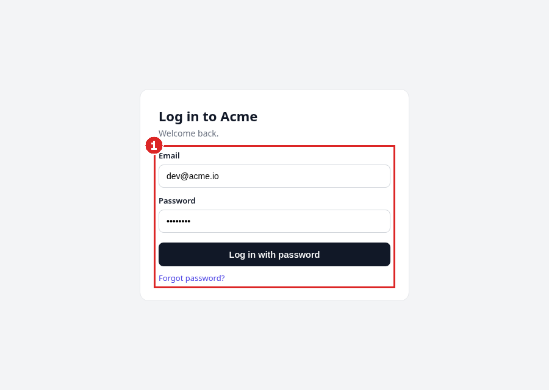
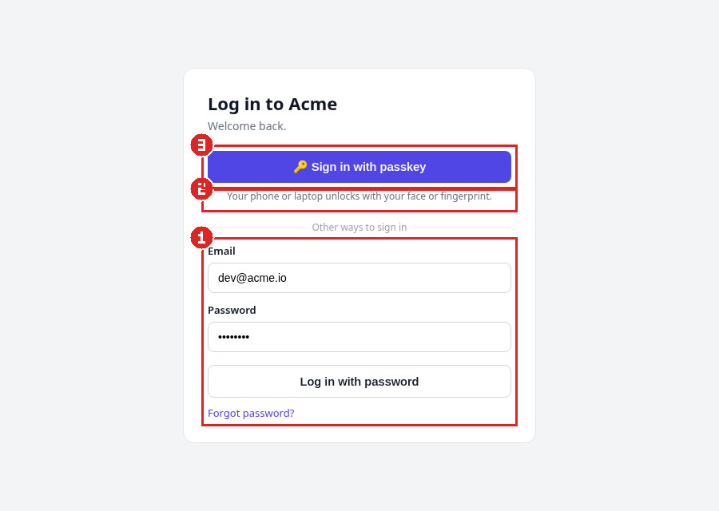
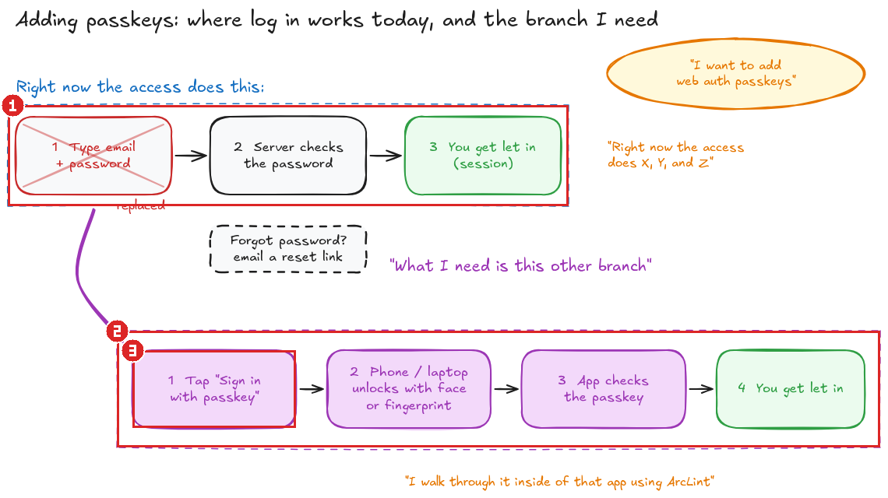

## Before and after: Passkeys

Sketch: [`.arclint/studio/features/54c300236da7b0fd98b111834c62b0d3.sketch.excalidraw`](https://raw.githubusercontent.com/wixregiga/arclint/feature-sketch-evidence/docs/evidence/passkeys/.arclint/studio/features/54c300236da7b0fd98b111834c62b0d3.sketch.excalidraw). Each number marks the same change on both screenshots and links to the named sketch part it implements.

| Before (current) | After (target) |
| --- | --- |
|  |  |

| # | Sketch part | Before: now | After: target | Links |
| --- | --- | --- | --- | --- |
| 1 | [`current-login`](https://raw.githubusercontent.com/wixregiga/arclint/feature-sketch-evidence/docs/evidence/passkeys/.arclint/studio/features/54c300236da7b0fd98b111834c62b0d3.sketch.excalidraw#current-login) Today: log in with email + password | Email + password is the only way in | Still there, moved under 'Other ways to sign in' | log-in, session |
| 2 | [`passkey-branch`](https://raw.githubusercontent.com/wixregiga/arclint/feature-sketch-evidence/docs/evidence/passkeys/.arclint/studio/features/54c300236da7b0fd98b111834c62b0d3.sketch.excalidraw#passkey-branch) The new branch: log in with a passkey | not present | New way in: phone or laptop unlocks with face or fingerprint | passkey, log-in |
| 3 | [`passkey-prompt`](https://raw.githubusercontent.com/wixregiga/arclint/feature-sketch-evidence/docs/evidence/passkeys/.arclint/studio/features/54c300236da7b0fd98b111834c62b0d3.sketch.excalidraw#passkey-prompt) 1 Tap "Sign in with passkey" | not present | 'Sign in with passkey' button at the top | passkey |

Sketch with the same numbers

